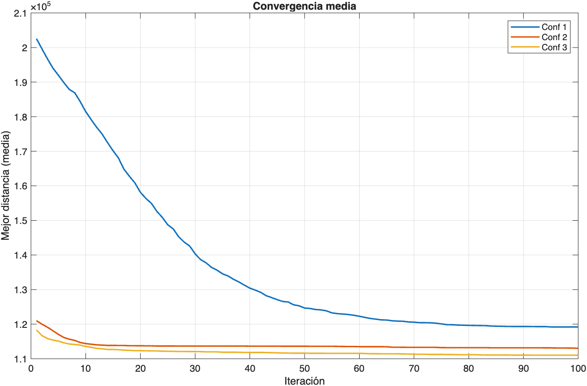

# Colonia de hormigas para rutas de reparto (CVRP)

Problema de rutas de vehículos con capacidad (*Capacitated Vehicle Routing
Problem*): un almacén central y **500 clientes**, cada uno con una demanda. Hay
que diseñar las rutas de una flota de vehículos iguales, de capacidad
*Q* = 245, minimizando la distancia total. Cada ruta sale del almacén y vuelve a
él, cada cliente se visita una sola vez y ningún vehículo puede llevar más de
*Q*. La demanda total es 9.029, así que hacen falta al menos 37 vehículos.

## Cómo funciona

Optimización por colonia de hormigas (ACO), en [`aco_cvrp.m`](aco_cvrp.m):

- **Construcción.** Cada hormiga parte del almacén y elige el siguiente cliente
  por ruleta, con probabilidad proporcional a τ^α · η^β. τ es la feromona del
  camino y η = 1/distancia, de modo que los clientes cercanos son más
  atractivos. Solo se consideran los clientes no visitados cuya demanda cabe en
  la carga que le queda. Si no cabe ninguno, vuelve al almacén a recargar y
  sigue. Así todas las soluciones construidas son válidas.
- **Feromona.** En cada iteración se evapora una fracción ρ y cada hormiga
  deposita Q / L en las aristas que ha usado, siendo L la distancia de su
  solución: las rutas cortas refuerzan más sus caminos.
- **Reinicio.** Si la mejor solución no mejora en 20 iteraciones, la feromona
  vuelve a su valor inicial para salir del estancamiento.

## Resultados

30 ejecuciones independientes de 100 iteraciones con 30 hormigas para cada
configuración. Las dos primeras son configuraciones de partida habituales; la tercera es
la que propuse tras analizarlas.

| Configuración | α | β | ρ | Distancia media ± desv. | Mejor | Tiempo por ejecución |
|---|---|---|---|---|---|---|
| Conf 1 | 1 | 2 | 0,1 | 119.203 ± 967 | 116.890 | 4,4 s |
| Conf 2 | 1 | 5 | 0,5 | 113.010 ± 665 | 111.633 | 4,8 s |
| **Conf 3** | **2** | **6** | **0,3** | **111.025 ± 714** | **109.186** | 4,8 s |

- **β es el parámetro decisivo.** Con β = 2 (conf 1) la distancia pesa poco y
  las primeras soluciones son casi aleatorias (unos 200.000). La colonia tarda
  unas 60 iteraciones en aprender buenas rutas solo con la feromona y aun así
  acaba la peor. Con β = 5 o 6 la heurística de cercanía da soluciones buenas
  desde la primera iteración.
- **La conf 3 es la mejor** en media y en mejor resultado, y las cajas no se
  solapan con las otras dos. Un α más alto hace que la colonia siga más la
  feromona acumulada y explote las buenas rutas encontradas. Con ρ = 0,3 la
  feromona no se evapora tan deprisa como con 0,5 ni se acumula tanto como
  con 0,1.
- Las configuraciones 2 y 3 convergen en unas 15 iteraciones y después apenas
  mejoran: sin búsqueda local (por ejemplo 2-opt dentro de cada ruta) el ACO
  deja cruces dentro de las rutas que no corrige.

La mejor solución usa 38 vehículos (el mínimo posible es 37). El script
comprueba que es válida: cada cliente aparece una sola vez y ninguna ruta supera
la capacidad.

## Cómo ejecutarlo

Ejecutar `ejecutar_aco.m` en MATLAB (tarda unos 7 minutos). Los datos están en
`datos/instance_cvrp.mat`: coordenadas, demandas, matriz de distancias y
capacidad *Q*.
