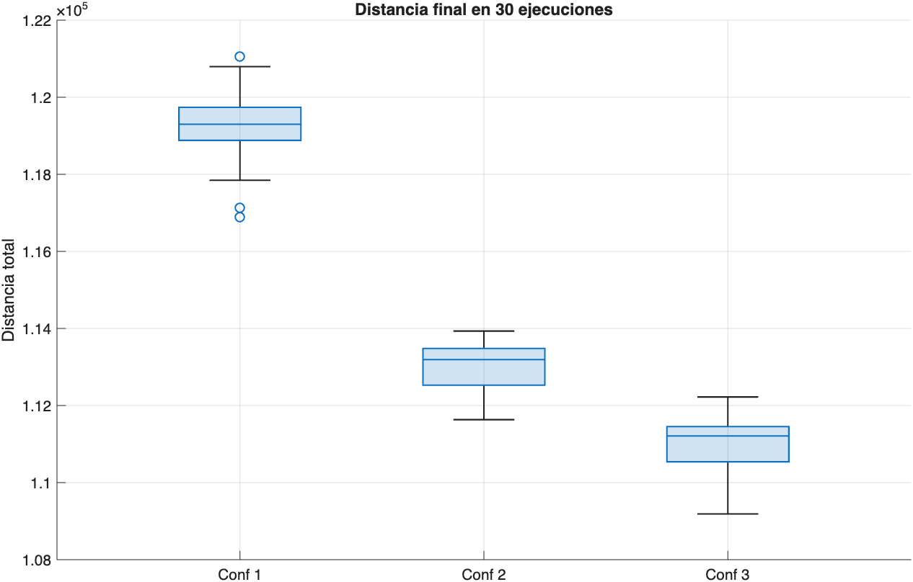
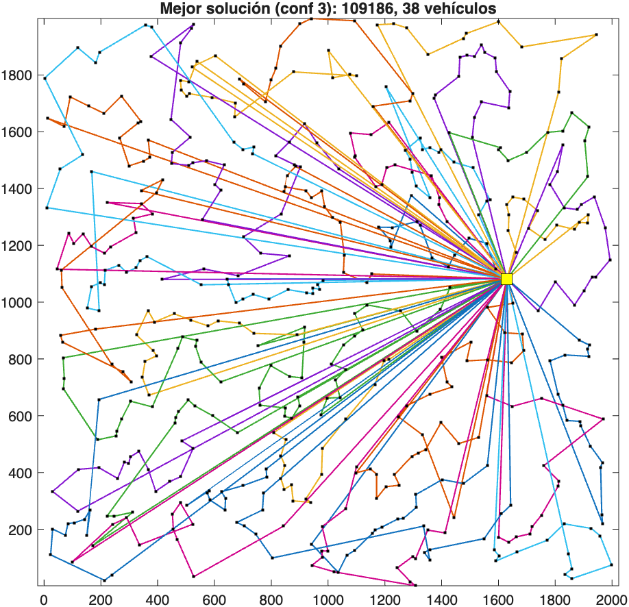

# Ant colony optimization for vehicle routing (CVRP)

Capacitated Vehicle Routing Problem: a central depot and **500 customers**, each
with a demand. The routes of a fleet of identical vehicles with capacity
*Q* = 245 must be designed so that the total distance is minimal. Each route
starts and ends at the depot, each customer is visited exactly once and no
vehicle can carry more than *Q*. The total demand is 9,029, so at least 37
vehicles are needed.

## How it works

Ant colony optimization (ACO), in [`aco_cvrp.m`](aco_cvrp.m):

- **Construction.** Each ant starts at the depot and chooses the next customer
  by roulette wheel, with probability proportional to τ^α · η^β, where τ is the
  pheromone on the edge and η = 1/distance, so nearby customers are more
  attractive. Only unvisited customers whose demand fits in the remaining load
  are considered. If none fits, the ant returns to the depot to reload and
  continues. This way every constructed solution is valid.
- **Pheromone.** At each iteration a fraction ρ evaporates and each ant deposits
  Q / L on the edges it used, where L is the distance of its solution: short
  routes reinforce their edges more.
- **Restart.** If the best solution does not improve in 20 iterations, the
  pheromone is reset to its initial value to escape stagnation.

## Results

30 independent runs of 100 iterations with 30 ants for each configuration. The
first two are common starting configurations; the third is the one I proposed
after analysing them.

| Configuration | α | β | ρ | Mean distance ± std. | Best | Time per run |
|---|---|---|---|---|---|---|
| Conf 1 | 1 | 2 | 0.1 | 119,203 ± 967 | 116,890 | 4.4 s |
| Conf 2 | 1 | 5 | 0.5 | 113,010 ± 665 | 111,633 | 4.8 s |
| **Conf 3** | **2** | **6** | **0.3** | **111,025 ± 714** | **109,186** | 4.8 s |

- **β is the key parameter.** With β = 2 (conf 1) distance carries little
  weight and the first solutions are almost random (around 200,000). The colony
  needs about 60 iterations to learn good routes from pheromone alone and still
  ends up the worst. With β = 5 or 6 the proximity heuristic gives good
  solutions from the very first iteration.
- **Conf 3 is the best** both on average and in its best result, and its box
  does not overlap with the other two. A higher α makes the colony follow the
  accumulated pheromone more closely and exploit the good routes found. With
  ρ = 0.3 the pheromone neither evaporates as quickly as with 0.5 nor
  accumulates as much as with 0.1.
- Configurations 2 and 3 converge in about 15 iterations and barely improve
  afterwards: without local search (for example 2-opt within each route), ACO
  leaves crossings inside the routes that it does not fix.

The best solution uses 38 vehicles (the minimum possible is 37). The script
checks that it is valid: each customer appears exactly once and no route
exceeds the capacity.

## How to run

Run `ejecutar_aco.m` in MATLAB (it takes about 7 minutes). The data is in
`datos/instance_cvrp.mat`: coordinates, demands, distance matrix and capacity
*Q*.
