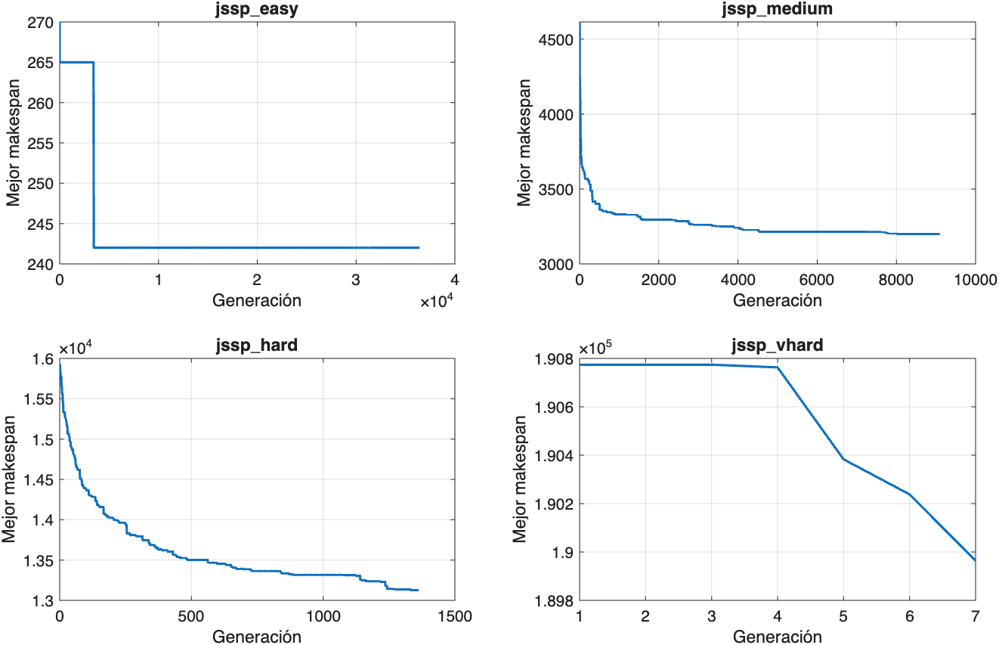

# Algoritmo genético para el Job Shop Scheduling Problem

Planificación de *J* trabajos en *M* máquinas: cada trabajo es una secuencia
ordenada de operaciones, cada una en una máquina concreta y con una duración
fija. Cada máquina solo puede hacer una operación a la vez y las operaciones no
se interrumpen. El objetivo es minimizar el **makespan**, es decir, el instante
en que termina el último trabajo.

## Cómo funciona

- **Representación entera por operaciones.** El cromosoma contiene el índice de
  cada trabajo tantas veces como operaciones tiene. Leído de izquierda a
  derecha, la *q*-ésima aparición del trabajo *j* es su *q*-ésima operación.
  Cualquier reordenación de los genes es una planificación válida, así que nunca
  hay que reparar soluciones.
- **Decodificación voraz.** Cada operación empieza en cuanto han terminado la
  operación anterior de su trabajo y lo que esté ocupando su máquina.
- **Cruce JOX** (*Job-based Order Crossover*). Los cruces clásicos de
  permutaciones (PMX, OX) suponen que cada gen aparece una sola vez, y el cruce
  de un punto descuadra el número de apariciones de cada trabajo. JOX elige un
  trabajo al azar: cada hijo mantiene las posiciones de ese trabajo en un padre y
  rellena el resto con los genes del otro padre, en su orden.
- **Mutación por inversión** de un tramo del cromosoma.
- **Selección por torneo** y **reemplazo elitista** (sobreviven los mejores
  entre padres e hijos).

## Resultados

Cada instancia se ejecuta con un límite de tiempo fijo. La cota
inferior es el máximo entre la carga de la máquina más ocupada y la duración del
trabajo más largo: ninguna planificación puede bajar de ahí, aunque suele
quedar bastante lejos del óptimo real.

| Instancia | Trabajos × máquinas | Tiempo | Makespan | Cota inferior | Generaciones |
|---|---|---|---|---|---|
| easy | 6 × 6 | 10 s | 242 | 199 | 36.432 |
| medium | 30 × 30 | 15 s | 3.199 | 1.841 | 9.099 |
| hard | 100 × 80 | 20 s | 13.127 | 5.558 | 1.362 |
| very hard | 1000 × 800 | 30 s | 189.964 | 52.748 | 7 |

- En la instancia pequeña la mejor solución aparece en unas 3.000
  generaciones y ya no cambia. En *medium* y *hard* casi toda la mejora llega
  en las primeras centenas de generaciones; después el reemplazo elitista
  hace que la población pierda diversidad y el avance son pequeños escalones
  que dependen de que una mutación acierte.
- En la instancia de 1000 trabajos (800.000 operaciones) cada evaluación es
  tan costosa que en 30 s solo caben 7 generaciones. Ahí el límite es el tiempo
  y no el algoritmo: la decodificación recorre el cromosoma operación a
  operación.

## Cómo ejecutarlo

Ejecutar `ejecutar_jssp.m` en MATLAB (tarda unos 80 segundos). Lee las
instancias de `instancias/`, imprime la tabla y guarda las figuras.

`solve_int_ga.m` se puede usar por separado con cualquier instancia:
`[best_sol, best_cost, log, num_gens] = solve_int_ga(M_maquinas, M_tiempos, time_limit)`.
