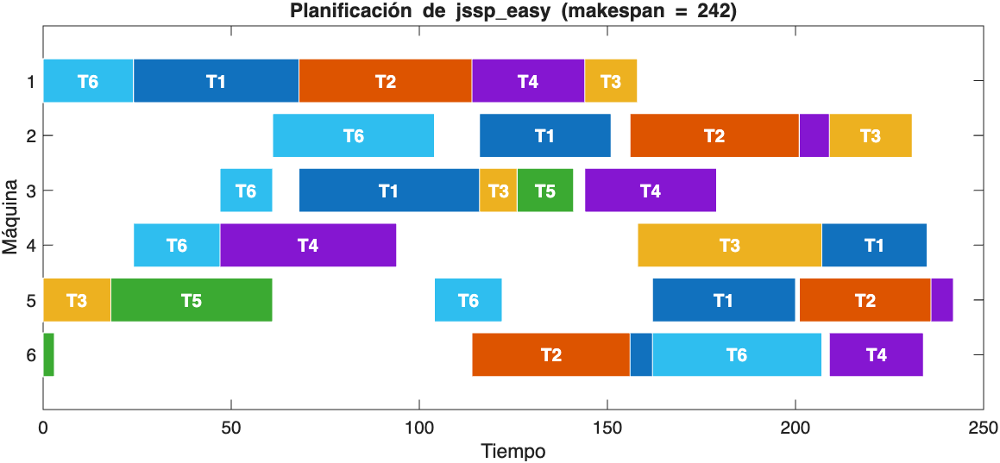

# Genetic algorithm for the Job Shop Scheduling Problem

Scheduling *J* jobs on *M* machines: each job is an ordered sequence of
operations, each one on a specific machine and with a fixed duration. Each
machine can only process one operation at a time and operations cannot be
interrupted. The goal is to minimize the **makespan**, that is, the time at
which the last job finishes.

## How it works

- **Operation-based integer encoding.** The chromosome contains the index of
  each job as many times as it has operations. Read from left to right, the
  *q*-th occurrence of job *j* is its *q*-th operation. Any reordering of the
  genes is a valid schedule, so solutions never need to be repaired.
- **Greedy decoding.** Each operation starts as soon as the previous operation
  of its job and whatever is running on its machine have finished.
- **JOX crossover** (*Job-based Order Crossover*). Classic permutation
  crossovers (PMX, OX) assume each gene appears only once, and one-point
  crossover breaks the number of occurrences of each job. JOX picks a random
  job: each child keeps the positions of that job from one parent and fills the
  rest with the genes of the other parent, in their order.
- **Inversion mutation** of a segment of the chromosome.
- **Tournament selection** and **elitist replacement** (the best among parents
  and children survive).

## Results

Each instance is run with a fixed time limit. The lower bound is the maximum
between the load of the busiest machine and the duration of the longest job: no
schedule can go below it, although it is usually quite far from the true
optimum.

| Instance | Jobs × machines | Time | Makespan | Lower bound | Generations |
|---|---|---|---|---|---|
| easy | 6 × 6 | 10 s | 242 | 199 | 36,432 |
| medium | 30 × 30 | 15 s | 3,199 | 1,841 | 9,099 |
| hard | 100 × 80 | 20 s | 13,127 | 5,558 | 1,362 |
| very hard | 1000 × 800 | 30 s | 189,964 | 52,748 | 7 |

- On the small instance the best solution appears after about 3,000
  generations and does not change afterwards. On *medium* and *hard* almost all
  the improvement comes in the first few hundred generations; after that,
  elitist replacement makes the population lose diversity and progress comes in
  small steps that depend on a lucky mutation.
- On the 1000-job instance (800,000 operations) each evaluation is so expensive
  that only 7 generations fit in 30 s. There the limit is the time budget, not
  the algorithm: decoding walks through the chromosome operation by operation.

## How to run

Run `ejecutar_jssp.m` in MATLAB (it takes about 80 seconds). It reads the
instances from `instancias/`, prints the table and saves the figures.

`solve_int_ga.m` can be used on its own with any instance:
`[best_sol, best_cost, log, num_gens] = solve_int_ga(M_maquinas, M_tiempos, time_limit)`.
