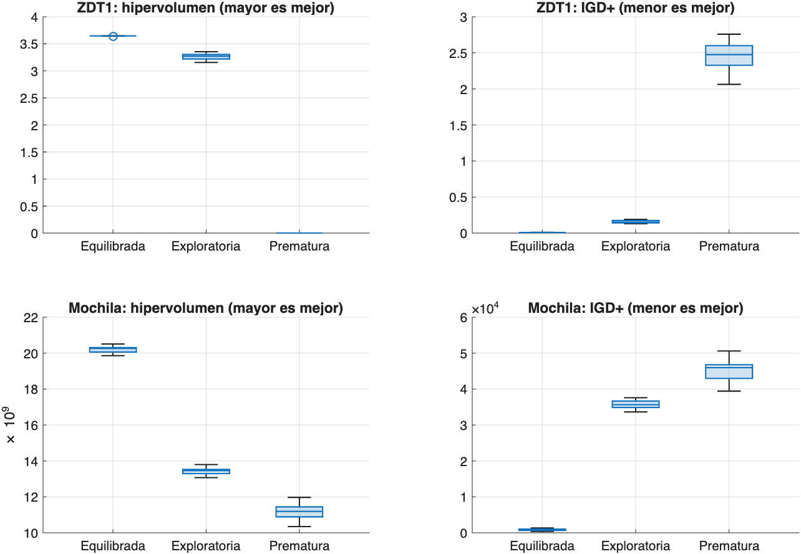
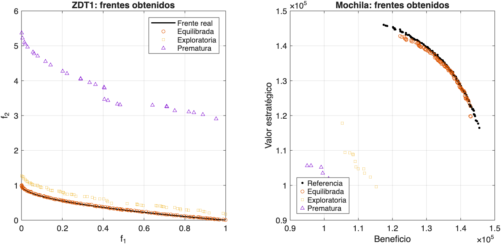

# NSGA-II: optimización multiobjetivo

Implementación de **NSGA-II** (*Non-dominated Sorting Genetic Algorithm II*)
aplicada a dos problemas de distinta naturaleza, con dos objetivos en conflicto
en cada uno. En lugar de una única solución óptima se busca el **frente de
Pareto**: las soluciones en las que no se puede mejorar un objetivo sin
empeorar el otro.

- **ZDT1 (continuo).** 50 variables en [0, 1] y dos objetivos a minimizar. Es un
  problema de prueba estándar y su frente de Pareto exacto se conoce:
  f₂ = 1 − √f₁.
- **Mochila multiobjetivo (discreto y con restricción).** 500 objetos: hay que
  elegir cuáles meter para maximizar a la vez el beneficio económico y el valor
  estratégico, sin superar el peso máximo.

## Cómo funciona

El núcleo del algoritmo ([`nsga2.m`](nsga2.m)) es común a los dos problemas:

1. **Ordenación por dominancia.** Una solución domina a otra si no es peor en
   ningún objetivo y es mejor en al menos uno. El frente 1 lo forman las que
   nadie domina; el frente 2, las que solo dominan las del frente 1; y así
   sucesivamente. Está vectorizada: la matriz de dominancia de toda la
   población se calcula de una vez.
2. **Distancia de crowding.** Dentro de cada frente mide lo aislada que está
   cada solución. Se prefieren las de zonas poco pobladas para mantener el
   frente repartido, y los extremos se conservan siempre.
3. **Selección por torneo binario** (gana el de menor frente y, si empatan, el
   de mayor crowding), cruce y mutación.
4. **Selección elitista.** Padres e hijos se juntan y sobreviven los mejores
   frentes completos. El último frente que no cabe entero se recorta por
   crowding.

Operadores de cada problema ([`ejecutar_nsga2.m`](ejecutar_nsga2.m)):

| | ZDT1 (continuo) | Mochila (binario) |
|---|---|---|
| Cruce | SBX (*Simulated Binary Crossover*) | Uniforme |
| Mutación | Polinómica | Inversión de bits |
| Restricción | — | **Reparación**: si una solución supera el peso, se quitan objetos al azar hasta que cabe |

Se eligió reparar en lugar de penalizar para que todas las soluciones de la
población sean válidas y el frente final no contenga mochilas imposibles.

## Experimentos

Tres configuraciones por problema, pensadas para provocar comportamientos
distintos, con **30 ejecuciones independientes** cada una:

| Configuración | Población | Generaciones | P. cruce | P. mutación | Idea |
|---|---|---|---|---|---|
| Equilibrada | 120 | 500 | 0,9 | 0,1 (ZDT1) / 1/500 (mochila) | Tiempo suficiente para converger |
| Exploratoria | 200 | 100 | 0,7 | 0,1 / 0,05 | Mucha diversidad y mutación, poco tiempo |
| Prematura | 30 | 30–40 | 0,95 | 0,001 | Población pequeña y casi sin mutación |

En ZDT1 se ajustan también los índices de distribución de SBX y de la mutación
polinómica (η = 15/20, 5/5 y 50/50): con η alto los hijos salen muy pegados a
los padres.

Métricas:
- **Hipervolumen (HV).** Área del espacio de objetivos dominada por el frente,
  hasta un punto de referencia. Recoge a la vez la convergencia y la diversidad.
  Mayor es mejor.
- **IGD+.** Para cada punto del frente de referencia, la distancia a la solución
  obtenida más cercana, contando solo en lo que esta es peor. Penaliza los huecos
  y las zonas sin cubrir. Menor es mejor. En ZDT1 la referencia es el frente
  exacto. En la mochila, que no lo tiene conocido, se usan las soluciones no
  dominadas de todas las ejecuciones juntas.

## Resultados

| Problema | Configuración | HV (media ± desv.) | IGD+ (media ± desv.) |
|---|---|---|---|
| ZDT1 | **Equilibrada** | **3,648 ± 0,002** | **0,0086 ± 0,0007** |
| ZDT1 | Exploratoria | 3,264 ± 0,052 | 0,156 ± 0,019 |
| ZDT1 | Prematura | 0 ± 0 | 2,45 ± 0,18 |
| Mochila | **Equilibrada** | **2,021·10¹⁰ ± 1,6·10⁸** | **848 ± 230** |
| Mochila | Exploratoria | 1,344·10¹⁰ ± 1,7·10⁸ | 35.660 ± 1.086 |
| Mochila | Prematura | 1,118·10¹⁰ ± 3,6·10⁸ | 45.269 ± 2.724 |

- **La configuración equilibrada es la mejor en los dos problemas** y con mucha
  diferencia. En ZDT1 su frente se superpone al exacto (IGD+ < 0,01). En la
  mochila recorre casi todo el frente de referencia.
- **La exploratoria** mantiene un frente bien repartido, pero con solo 100
  generaciones no llega a converger: queda por encima del frente real en ZDT1 y
  muy por detrás en la mochila.
- **La prematura** se estanca lejos del frente. En ZDT1 todos sus puntos quedan
  fuera del punto de referencia del hipervolumen (2, 2), así que su **HV es 0
  en las 30 ejecuciones**. Ahí el HV ya no distingue entre una ejecución mala y
  otra peor, y es IGD+ quien sigue midiendo cuánto se aleja. Para eso sirve
  tener dos métricas.
- **Continuo frente a discreto.** En ZDT1 basta con mover las variables poco a
  poco hacia el frente. En la mochila, con 500 objetos y la restricción de
  peso, el espacio es enorme y casi cualquier cambio rompe la restricción, que
  hay que reparar. Por eso la diferencia entre configuraciones es mucho mayor:
  sin generaciones suficientes ni una mutación baja y constante, el frente se
  queda muy lejos.
- La comparación visual de los frentes confirma las métricas, pero las métricas
  permiten comparar las 30 ejecuciones a la vez y ver además la estabilidad: la
  configuración equilibrada es también la de menor dispersión.

## Cómo ejecutarlo

Ejecutar `ejecutar_nsga2.m` en MATLAB (tarda unos 2 minutos). Los datos de la
mochila están en `datos/instancia_mokp.mat`: beneficios, valores estratégicos,
pesos y capacidad máxima.
