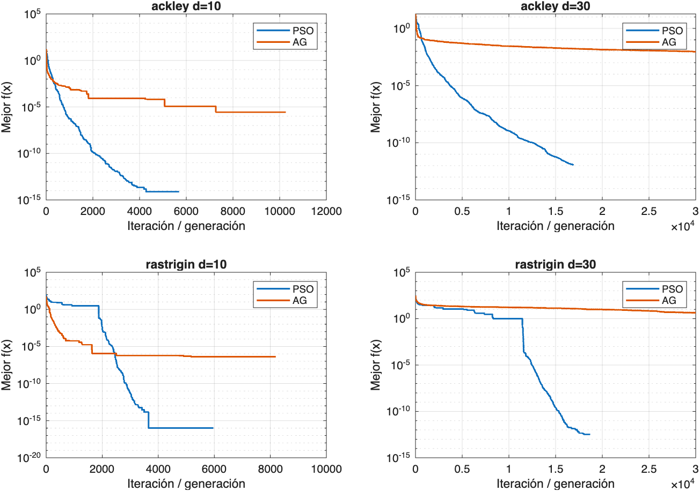

# PSO vs. real-coded genetic algorithm

Experimental comparison of two population-based metaheuristics for continuous
optimization: **particle swarm optimization (PSO)** and a **real-coded genetic
algorithm (GA)**. Two classic multimodal functions are used, in 10 and 30
dimensions:

- **Ackley**: an almost flat plateau with a narrow funnel towards the optimum at
  x = 0.
- **Rastrigin**: a regular grid of thousands of local minima around the optimum,
  also at x = 0.

## How it works

**PSO** ([`run_PSO.m`](run_PSO.m)). Each particle has a position, a velocity
and the best position it has visited. At each iteration the velocity combines
inertia (w = 0.8), attraction towards its own best position (cp = 1.8) and
attraction towards the best position of the swarm (cg = 2.4). Particles that
leave the domain stay on its boundary.

**Real-coded GA** ([`run_GA_real.m`](run_GA_real.m)). No binary encoding: each
individual is directly a vector of real numbers.
- Tournament selection (k = 3).
- **Arithmetic crossover**: the children are combinations a·P1 + (1−a)·P2 with
  random *a*, so they lie between their two parents.
- **Gaussian mutation**: N(0, σ) noise is added to each gene with probability
  0.2. σ is 1 % of the domain for Ackley and 5 % for Rastrigin, which needs
  larger jumps to escape its local minima.
- Elitist replacement.

Both are vectorized: the whole population is evaluated and updated at once,
without per-individual loops. For a fair comparison they use the same
population size (250), the same domain and the same stopping criterion: at most
30,000 iterations, or 3,000 in a row without improvement.

### A PSO detail that makes the difference

In the velocity formula, the random numbers r1 and r2 can be drawn once per
dimension or once per particle. Here **one per particle** is used: each
particle moves in a straight line towards its own best position and towards the
global best. Both options were tested with these same parameters, and with one
random number per dimension the swarm gets stuck in local minima of Rastrigin
(f ≈ 2 in 10 dimensions and f ≈ 47 in 30, median of 5 runs). With one per
particle it reaches the optimum in every case.

## Results

Final value of f(x) (the optimum is 0) and number of successful runs
(f(x) < 10⁻³), over 5 independent runs per case:

| Function | d | PSO: mean | PSO success | GA: mean | GA success |
|---|---|---|---|---|---|
| Ackley | 10 | 7.6·10⁻¹⁵ | 5/5 | 3.6·10⁻⁵ | 5/5 |
| Ackley | 30 | 1.1·10⁻¹² | 5/5 | 8.6·10⁻³ | 0/5 |
| Rastrigin | 10 | 0 | 5/5 | 5.1·10⁻⁷ | 5/5 |
| Rastrigin | 30 | 4.4·10⁻¹³ | 5/5 | 1.43 | 0/5 |

Ackley was also run 100 times, with the same outcome: PSO 100/100 in both
dimensions; GA 100/100 for d = 10 and 0/100 for d = 30.

- **Convergence speed.** PSO decreases steadily down to machine precision
  (~10⁻¹⁵). The GA improves quickly at first, but then progresses in jumps:
  refining the last decimals depends on a lucky mutation.
- **Dimensionality.** Going from 10 to 30 dimensions barely affects PSO, which
  just needs more iterations. It affects the GA a lot: in 30 dimensions it uses
  up all 30,000 generations without reaching the success threshold.
- **Multimodality.** On Rastrigin, PSO stays stuck on a plateau for a while
  (f ≈ 1, a single local minimum) and then suddenly drops to the optimum: the
  attraction towards the global best pulls the whole swarm out of the minimum.
  In 30 dimensions the GA gets stuck in different local minima depending on the
  run (f between 0 and 5).
- **Robustness.** The spread between PSO runs is minimal. The GA's is larger,
  especially on Rastrigin 30, where its result depends on which local minimum it
  stalls in.

### Is the centred optimum giving an unfair advantage?

Both functions have their optimum at the centre of the domain, and both the
arithmetic crossover and the movement of particles towards other positions
could favour the centre. That is why everything was repeated with the optimum
moved to x = 0.3 · limit. The results do not change: PSO still solves all four
cases and the GA fails in the same ones.

## How to run

- `visualizar_funciones.m`: surfaces and contour plots of both functions.
- `comparar_pso_ag.m`: the full experiment, with the table, the shifted-optimum
  check and the figures. With 5 runs per case it takes about 2 minutes. To
  repeat it with more runs, just change `N_RUNS`.
