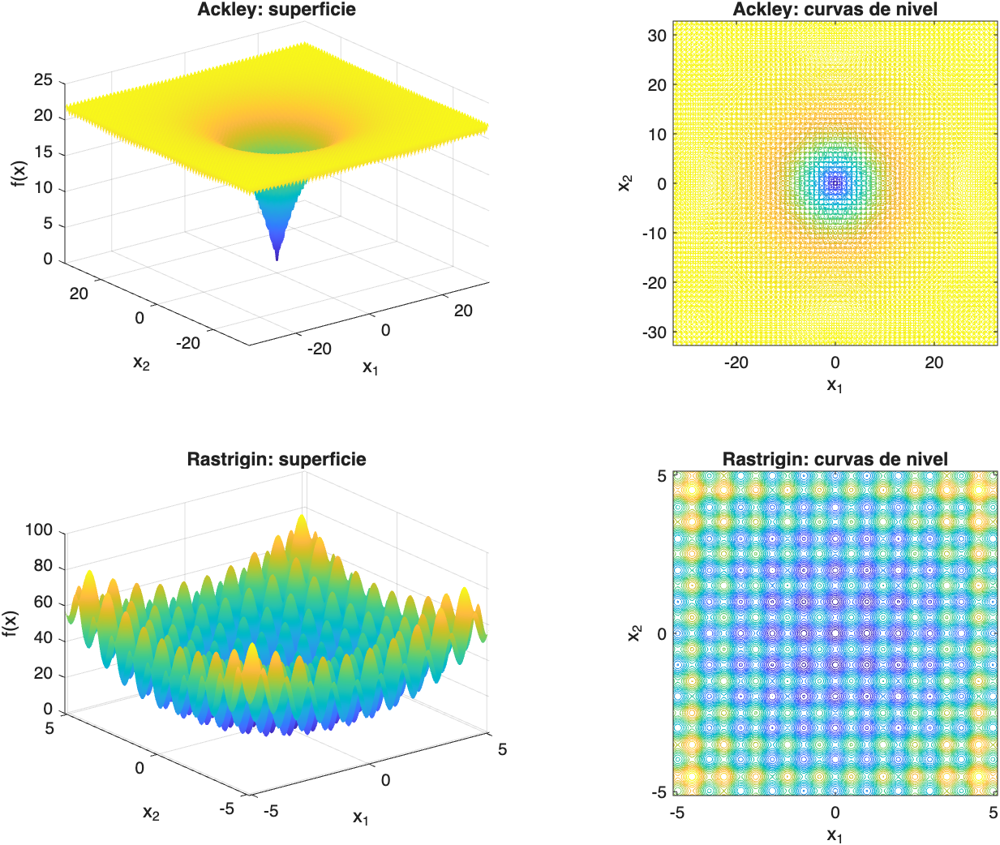
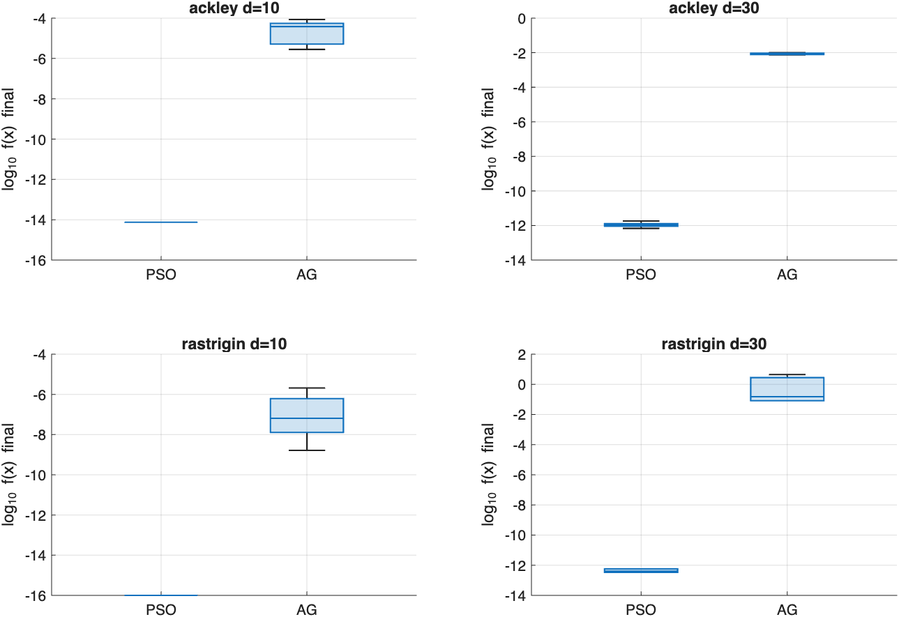

# PSO contra algoritmo genético con codificación real

Comparación experimental de dos metaheurísticas poblacionales en optimización
continua: **optimización por enjambre de partículas (PSO)** y un **algoritmo
genético (AG) con codificación real**. Se usan dos funciones multimodales
clásicas, en 10 y 30 dimensiones:

- **Ackley**: una meseta casi plana con un embudo estrecho hacia el óptimo, en
  x = 0.
- **Rastrigin**: una rejilla regular de miles de mínimos locales alrededor del
  óptimo, también en x = 0.

## Cómo funciona

**PSO** ([`run_PSO.m`](run_PSO.m)). Cada partícula tiene posición, velocidad y
la mejor posición que ha visitado. En cada iteración la velocidad combina
inercia (w = 0,8), atracción hacia su mejor posición (cp = 1,8) y atracción
hacia la mejor del enjambre (cg = 2,4). Las partículas que salen del dominio se
quedan en el borde.

**AG real** ([`run_GA_real.m`](run_GA_real.m)). Sin binarizar: cada individuo es
directamente un vector de números reales.
- Selección por torneo (k = 3).
- **Cruce aritmético**: los hijos son combinaciones a·P1 + (1−a)·P2 con *a*
  aleatorio, así que quedan entre los dos padres.
- **Mutación gaussiana**: a cada gen se le suma ruido N(0, σ) con probabilidad
  0,2. σ es el 1 % del dominio en Ackley y el 5 % en Rastrigin, que necesita
  saltos más grandes para escapar de sus mínimos locales.
- Reemplazo elitista.

Los dos están vectorizados: toda la población se evalúa y actualiza a la vez,
sin bucles por individuo. Para que la comparación sea justa usan la misma
población (250), el mismo dominio y el mismo criterio de parada: 30.000
iteraciones como máximo o 3.000 seguidas sin mejorar.

### Un detalle del PSO que marca la diferencia

En la fórmula de la velocidad, los números aleatorios r1 y r2 pueden ser uno
por dimensión o uno por partícula. Aquí se usa **uno por partícula**: cada
partícula se mueve en línea recta hacia su mejor posición y hacia la mejor
global. Se probaron las dos opciones con estos mismos parámetros, y con un
aleatorio por dimensión el enjambre se queda atascado en mínimos locales de
Rastrigin (f ≈ 2 en 10 dimensiones y f ≈ 47 en 30, mediana de 5 ejecuciones).
Con uno por partícula llega al óptimo en todos los casos.

## Resultados

Valor final de f(x) (el óptimo es 0) y número de ejecuciones con éxito
(f(x) < 10⁻³), en 5 ejecuciones independientes por caso:

| Función | d | PSO: media | Éxito PSO | AG: media | Éxito AG |
|---|---|---|---|---|---|
| Ackley | 10 | 7,6·10⁻¹⁵ | 5/5 | 3,6·10⁻⁵ | 5/5 |
| Ackley | 30 | 1,1·10⁻¹² | 5/5 | 8,6·10⁻³ | 0/5 |
| Rastrigin | 10 | 0 | 5/5 | 5,1·10⁻⁷ | 5/5 |
| Rastrigin | 30 | 4,4·10⁻¹³ | 5/5 | 1,43 | 0/5 |

En Ackley se repitió además con 100 ejecuciones y el resultado es el mismo: PSO 100/100 en las dos dimensiones; AG
100/100 en d = 10 y 0/100 en d = 30.

- **Velocidad de convergencia.** El PSO baja de forma continua hasta la
  precisión de la máquina (~10⁻¹⁵). El AG mejora rápido al principio, pero
  después avanza a saltos: refinar los últimos decimales depende de que una
  mutación acierte.
- **Dimensionalidad.** Pasar de 10 a 30 dimensiones apenas afecta al PSO, que
  solo necesita más iteraciones. Al AG le afecta mucho: en 30 dimensiones
  agota las 30.000 generaciones sin llegar al umbral de éxito.
- **Multimodalidad.** En Rastrigin el PSO se queda un tiempo atascado en una
  meseta (f ≈ 1, un único mínimo local) y luego cae de golpe al óptimo: la
  atracción hacia la mejor posición global saca a todo el enjambre del mínimo.
  El AG en 30 dimensiones se queda en varios mínimos locales distintos según la
  ejecución (f entre 0 y 5).
- **Robustez.** La dispersión entre ejecuciones del PSO es mínima. La del AG es
  mayor, sobre todo en Rastrigin 30, donde su resultado depende de en qué
  mínimo local se estanque.

### ¿Hay truco por tener el óptimo en el centro?

Las dos funciones tienen el óptimo en el centro del dominio, y tanto el cruce
aritmético como el movimiento de las partículas hacia otras posiciones podrían
favorecer el centro. Por eso se repitió todo moviendo el óptimo a
x = 0,3 · límite. Los resultados no cambian: el PSO sigue resolviendo los
cuatro casos y el AG falla en los mismos.

## Cómo ejecutarlo

- `visualizar_funciones.m`: superficies y curvas de nivel de las dos funciones.
- `comparar_pso_ag.m`: el experimento completo, con tabla, comprobación con el
  óptimo desplazado y figuras. Con 5 ejecuciones por caso tarda unos 2 minutos.
  Para repetirlo con más, basta con cambiar `N_RUNS`.
