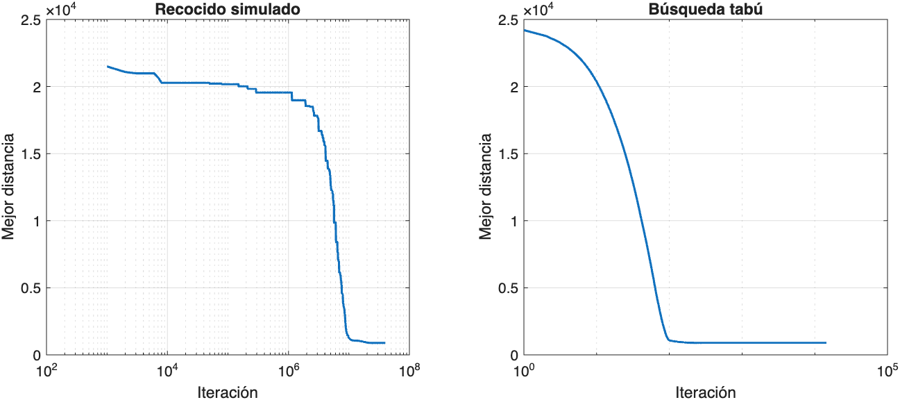

# Recocido simulado y búsqueda tabú para el problema del viajante

Dos metaheurísticas de trayectoria aplicadas al problema del viajante (TSP):
encontrar la ruta cerrada más corta que pasa una vez por cada ciudad. Las
instancias tienen las ciudades **agrupadas en clusters** pequeños y muy
separados, lo que llena el problema de óptimos locales: un mal orden de visita
de los clusters cuesta mucho y es difícil de corregir con cambios pequeños.

## Cómo funciona

Las dos usan el vecindario **2-opt**: se eligen dos posiciones de la ruta y se
invierte el tramo entre ellas. Solo cambian dos aristas, así que la variación de
la distancia se calcula en O(1) sin recorrer la ruta entera.

**Recocido simulado** ([`solve_tsp_sa.m`](solve_tsp_sa.m))
- En cada iteración prueba un movimiento 2-opt al azar. Si mejora se acepta; si
  empeora en Δ, se acepta con probabilidad e^(−Δ/T).
- La temperatura baja de forma geométrica desde T₀ = 1000 hasta 10⁻³ a lo largo
  del tiempo disponible. Al principio acepta casi todo (explora y puede cambiar
  el orden de los clusters) y al final solo mejoras (afina dentro de cada
  cluster). El enfriamiento va ligado al tiempo y no al número de iteraciones,
  para que llegue a enfriarse aunque el presupuesto sea de solo 5 s.

**Búsqueda tabú** ([`solve_tsp_tabu.m`](solve_tsp_tabu.m))
- En cada iteración evalúa los n(n−1)/2 movimientos 2-opt (vectorizado) y aplica
  el mejor que no esté prohibido, **aunque empeore**: así sale de los óptimos
  locales.
- Tras invertir el tramo entre las ciudades *b* y *c*, el par {*b*, *c*} queda
  tabú durante 40 iteraciones para no deshacer el movimiento.
- Criterio de aspiración: un movimiento tabú se permite si mejora la mejor ruta
  encontrada hasta el momento.

## Resultados

Longitud de la mejor ruta, con un límite de tiempo que crece con el tamaño de
la instancia:

| Instancia | Ciudades | Tiempo | Recocido simulado | Búsqueda tabú |
|---|---|---|---|---|
| tsp_0050 | 50 | 5 s | **241,95** | **241,95** |
| tsp_0100 | 100 | 10 s | **477,05** | 482,00 |
| tsp_0200 | 200 | 20 s | **885,78** | 889,93 |
| tsp_0500 | 500 | 30 s | **1.189,58** | 1.200,37 |
| tsp_1000 | 1000 | 60 s | **2.004,70** | 2.053,05 |

- En la instancia de 50 ciudades los dos llegan a la misma ruta. En las demás
  encuentran el mismo orden de visita de los clusters y la diferencia está en
  cómo se recorre cada cluster por dentro.
- El recocido hace decenas de millones de movimientos baratos; la tabú, unos
  miles de iteraciones caras (cada una evalúa todo el vecindario). La tabú baja
  muy deprisa al principio, pero con más ciudades cada iteración cuesta más y en
  el mismo tiempo hace menos, por eso la diferencia crece con *n*.
- El recocido pasa la primera parte del tiempo explorando a alta temperatura, y
  la mejora llega casi toda cuando la temperatura baja.

## Cómo ejecutarlo

Ejecutar `ejecutar_tsp.m` en MATLAB (tarda unos 4 minutos). Lee las instancias de
`instancias/` (primera línea: número de ciudades; después, una ciudad `x y` por
línea), imprime la tabla y guarda las figuras.

Las dos funciones se pueden usar por separado con cualquier conjunto de
ciudades: `[best_tour, best_dist, log] = solve_tsp_sa(coords, max_time)` y lo
mismo para `solve_tsp_tabu`.
