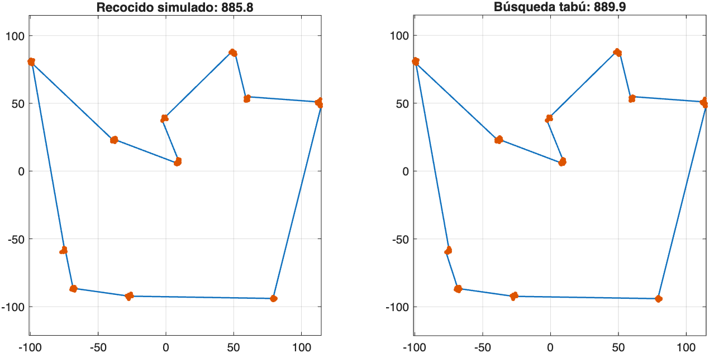

# Simulated annealing and tabu search for the travelling salesman problem

Two trajectory-based metaheuristics applied to the travelling salesman problem
(TSP): finding the shortest closed route that visits each city once. In these
instances the cities are **grouped in small clusters** far apart from each
other, which fills the problem with local optima: a bad order of visiting the
clusters is very costly and hard to fix with small changes.

## How it works

Both use the **2-opt** neighbourhood: two positions of the route are chosen and
the segment between them is reversed. Only two edges change, so the change in
length is computed in O(1) without traversing the whole route.

**Simulated annealing** ([`solve_tsp_sa.m`](solve_tsp_sa.m))
- At each iteration it tries a random 2-opt move. If it improves, it is
  accepted; if it worsens by Δ, it is accepted with probability e^(−Δ/T).
- The temperature decreases geometrically from T₀ = 1000 to 10⁻³ over the
  available time. At first it accepts almost everything (it explores and can
  change the order of the clusters) and at the end only improvements (it
  fine-tunes the route inside each cluster). Cooling is tied to time rather than
  to the number of iterations, so that it cools down fully even with a budget of
  only 5 s.

**Tabu search** ([`solve_tsp_tabu.m`](solve_tsp_tabu.m))
- At each iteration it evaluates all n(n−1)/2 2-opt moves (vectorized) and
  applies the best one that is not forbidden, **even if it is worse**: this is
  how it escapes local optima.
- After reversing the segment between cities *b* and *c*, the pair {*b*, *c*}
  stays tabu for 40 iterations so the move is not undone.
- Aspiration criterion: a tabu move is allowed if it improves the best route
  found so far.

## Results

Length of the best route, with a time limit that grows with the instance size:

| Instance | Cities | Time | Simulated annealing | Tabu search |
|---|---|---|---|---|
| tsp_0050 | 50 | 5 s | **241.95** | **241.95** |
| tsp_0100 | 100 | 10 s | **477.05** | 482.00 |
| tsp_0200 | 200 | 20 s | **885.78** | 889.93 |
| tsp_0500 | 500 | 30 s | **1,189.58** | 1,200.37 |
| tsp_1000 | 1000 | 60 s | **2,004.70** | 2,053.05 |

- On the 50-city instance both reach the same route. On the others they find
  the same order of visiting the clusters, and the difference lies in how each
  cluster is traversed internally.
- Simulated annealing performs tens of millions of cheap moves; tabu search, a
  few thousand expensive iterations (each one evaluates the whole
  neighbourhood). Tabu search drops very quickly at first, but with more cities
  each iteration costs more and fewer fit in the same time, which is why the gap
  grows with *n*.
- Simulated annealing spends the first part of the time exploring at high
  temperature, and almost all the improvement comes when the temperature drops.

## How to run

Run `ejecutar_tsp.m` in MATLAB (it takes about 4 minutes). It reads the
instances from `instancias/` (first line: number of cities; then one city `x y`
per line), prints the table and saves the figures.

Both functions can be used on their own with any set of cities:
`[best_tour, best_dist, log] = solve_tsp_sa(coords, max_time)`, and the same
for `solve_tsp_tabu`.
